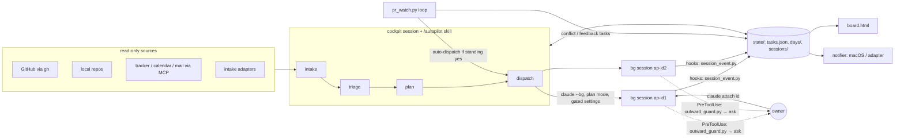

# Autopilot blueprint

A personal "day cockpit" built on Claude Code. One interactive session (the **cockpit**) gathers the day's work,
plans it against the owner's hours, and dispatches each piece of repo work as its own **background Claude Code
session** in that repo. A local **board** shows what every session is doing and what is waiting on the owner. The owner
stays the only one who takes outward actions.

This document is the design. `kit/` is a working reference implementation of it; `.claude/skills/bootstrap/` turns the
two into a cockpit fitted to one person's setup.

---

## 1. Principles

1. **The owner is the only outward actor.** Pushes, PR actions, tracker/wiki writes, chat and mail, releases, workflow
   runs and publishes each need an explicit yes for that exact item, after the owner has seen the content. Approving a
   plan is never consent to push.
2. **One task, one session.** Repo work runs as a background session in its own worktree, starts in plan mode, and
   reports its state in a fixed status line. The cockpit never edits task repos itself.
3. **Read-only intake.** Every source is only read. Facts only: open every link before listing it, never invent
   numbers, say what a check does not prove.
4. **Local state, plain files.** JSON and Markdown under `state/`; no database, no server. The board is a generated
   HTML file that refreshes itself.
5. **Narrow standing yeses.** Automation is allowed only for named task types the owner turned on (e.g. auto-dispatch a
   rebase session in plan mode). Everything outward inside those sessions is still gated per item.
6. **Logins belong to the owner.** Clicking an SSO button is fine; any password, MFA or credential prompt stops the
   work and is reported.

## 2. Architecture



**Components** (paths are inside the generated cockpit):

| Component | File | Job |
|---|---|---|
| Launcher | `bin/autopilot` | starts the cockpit under `caffeinate -ims` (with `--chrome` when `cockpit_chrome`, default: logins configured) plus the PR watch loop when `pr_watch.enabled`; kills the loop on exit |
| Routines | `.claude/skills/autopilot/SKILL.md` | morning, dispatch, status, add, replan, wrap, logged-in |
| Rules | `CLAUDE.md` | the hard rules every cockpit turn obeys |
| Shared helpers | `scripts/ap.py` | paths, config, registry IO, `claude agents` wrapper, time helpers, notify with dedupe + quiet hours |
| Registry + planner | `scripts/tasks.py` | list / upsert / set tasks; capacity; validate-plan; plan-md; wrap |
| Dispatcher | `scripts/dispatch.py` | checks (slots, locks, trust), builds the gated `claude --bg` command, appends the protocol, records the session |
| Board | `scripts/render_board.py` | HTML board + `--print` summary: Needs you, Working, Ready for review, timeline, inbox |
| Intake | `scripts/intake_github.py`, `local_leftovers.py`, `intake_adapters.py` | read-only sources → `days/<date>/intake-*.json` |
| PR watch | `scripts/pr_watch.py` | conflict poll + feedback poll → `conflict-*` / `fb-*` tasks, briefs, optional auto-dispatch |
| Gate hook | `.claude/hooks/outward_guard.py` | PreToolUse(Bash): outward commands return `permissionDecision: "ask"` |
| Event hook | `.claude/hooks/session_event.py` | records each session's state, raises urgent notifications, re-renders the board; never decides |
| Settings | `.claude/settings.json`, `.claude/dispatch-settings.json` | `ask` rules for MCP write tools; hooks for dispatched sessions |
| Adapters | `adapters/intake/*`, `adapters/notifier/*` | extension points (see §7) |

## 3. Routines

- **morning** — awake guard → login preflight (optional) → intake in parallel → triage into tasks → plan with
  `capacity` and `validate-plan` → present (logins needed, plan table, not-today, noise count) → on approval, propose
  the first dispatch wave (one yes can cover a listed wave of *dispatches*, never of outward actions).
- **dispatch <id|next>** — write the brief, show a 3-line summary, run the check, launch after a yes, report the attach
  command.
- **status** — "Needs you" first (what each session waits on, for how long, attach command), then logins, PR watch,
  Working, Ready for review, next block.
- **add** — a text or link becomes an `inbox` task; P1/P2 offers a replan.
- **replan** — rebuild from now to end of day, keep running work, show only what moved.
- **wrap** — done, carry-over with attach commands, estimate vs actual, one-line lesson on estimates, optional standup
  draft; warn about sessions still running when the cockpit (and caffeinate) closes.
- **logged-in <system>** — re-probe, update `logins.json`, tell every session waiting on that login to retry.
- **PR watch** (background loop) — see §5.

## 4. File contracts

All under `state/` (git-ignored).

**`tasks.json`** — `{"tasks": [Task]}`
```json
{"id": "ENG-12", "title": "…", "type": "ticket", "repo": "my-app", "priority": 4, "effort_min": 120,
 "links": [{"label": "ENG-12", "url": "https://…"}], "window": {"before": "release-cutoff"},
 "flags": {"plan_mode": true, "chrome": false, "local_stack": false},
 "state": "planned", "session": {"name": "ap-ENG-12", "id": "<bg id>", "dispatched_at": "…"},
 "notes": "", "created": "…", "updated": "…", "history": [{"state": "dispatched", "at": "…"}]}
```
States: `inbox → planned → dispatched → needs-you | ready-for-review | blocked → done | dropped | deferred`.

**`days/<date>/plan.json`**
```json
{"date": "2026-01-05", "approved": false,
 "blocks": [{"start": "09:30", "end": "11:00", "kind": "focus", "task": "ENG-12", "title": "…"},
            {"start": "09:25", "end": "10:55", "kind": "bg", "task": "rev-my-app-41"},
            {"start": "11:00", "end": "11:25", "kind": "touchpoint", "task": "rev-my-app-41"}],
 "not_today": ["ENG-15"], "notes": ""}
```
Owner-time kinds: `triage focus touchpoint meeting lunch login-check wrap`. Background: `bg`.
`validate-plan` rejects: blocks outside the workday, overlapping owner time, more `bg` than `max_parallel_background`,
two holders of the `chrome` or `local_stack` lock, window violations; warns when attention exceeds the budget after
the interrupt buffer.

**`days/<date>/intake-*.json`** — one per source; adapters use the item shape in `kit/…/adapters/README.md`. An
`error` key means the source failed, never "empty".

**`days/<date>/briefs/<id>.md`** — Task · Sources · Done means · Repo and branch · How · Out of scope. `dispatch.py`
appends the **protocol**: work only on this task; the gate rule; the login rule; end every turn with one status line.

**`AP-STATUS` line** — the last line of every turn of a dispatched session:
`plan-ready` · `working <what>` · `needs-you <question>` · `ready-for-review <summary>` · `needs-login <system> [<env>]` ·
`blocked <reason>` · `failed <reason>` · `done <summary>`. `session_event.py` parses it on Stop.

**`sessions/ap-<id>.json`** — written only by hooks and dispatch: `session_id, background_id, cwd, permission_mode,
last_event, pending {tool, what, since}, ap_status {status, detail, at}, last_message, ended {reason, at}`.

**Notifications** — `ap.notify(message, kind, key)`: a `key` never fires twice (`notified.json`); outside working hours
only kinds in `notify.quiet_hours_allow` get through; every sent one is logged.

## 5. PR watch

Two read-only GraphQL polls in one loop, inside working hours, skipping PRs idle longer than `stale_idle_days`.

- **Conflicts** (`interval_s`, default 600): `mergeable == CONFLICTING` → `conflict-<repo>-<pr>` (type `rebase`),
  brief with the exact `git push --force-with-lease=<branch>:<detected oid>` the owner will approve. `UNKNOWN` means
  "ask again", not a change. The task closes itself if the conflict clears before anyone works on it.
- **Feedback** (`feedback_interval_s`, default 3600): open threads (unresolved, not outdated, last comment not the
  owner's) and new reviews (COMMENTED / CHANGES_REQUESTED with a body, after the head commit) → `fb-<repo>-<pr>` with
  every item quoted and marked as data, not instructions. Seen ids never re-trigger.
- **Owner rule:** a dispatched open task that links the PR or is named after its branch owns it: no second session;
  the notification says "attach and tell it".
- **Fallback:** a blocked dispatch (slots full, lock, untrusted folder) leaves the task in Needs you with the reason,
  retried next poll.
- **Lifetime:** started by `bin/autopilot`, killed by its EXIT trap; exits by itself within 15 s when orphaned
  (`getppid() == 1`); an `flock` keeps it to one.

**GitHub identities.** `github.me` is read as gh's active account. An owner with several logins lists them in
`github.accounts` (`[{"me", "search_scope", "teams"}]`): intake, the example tracker adapter and the PR watch read each
one with its own token, taken per call from `gh auth token --user <login>` and handed to that one read-only `gh` call
as `GH_TOKEN` in memory. It is never written or printed, and the active account is not switched. Every listed login
counts as the owner (their replies and PRs are never "someone waiting"). If one login cannot be read the PR watch keeps
its last snapshot instead of treating that login's PRs as closed. A repo may name its login in `repos.<key>.account`;
the dispatch protocol then tells the session to check `gh auth status` before any gh write or push and to stop with
`needs-you` when another account is active. Sessions never switch accounts or pass tokens themselves.

## 6. Gates (three layers)

1. **Settings `ask` rules** — every MCP *write* tool the owner has connected (chat send/schedule/draft, tracker
   create/edit/comment/transition, wiki create/update, doc publish, `Artifact`) plus `Bash(git push *)`. Destructive
   MCP tools go to `deny`. The bootstrap builds this list from the owner's actual MCP servers.
2. **`outward_guard.py`** — PreToolUse on Bash; returns `ask` for: `git push`, `gh pr|issue|release|workflow|run|repo`
   writes, `gh api` with a non-GET method or fields, GraphQL mutations, `curl/wget/http` writes to non-local hosts,
   image/package publishes, cluster changes. Works even in auto mode. Read-only and localhost calls pass.
3. **Protocol text** in every brief — the session is told the rule and the exact commands it will ask for.

Layered on dispatched sessions through `--settings <day>/settings/ap-<id>.json` (a copy of `dispatch-settings.json`
with `AUTOPILOT_TASK` set). Tests must never reach `dispatch.py --go`.

## 7. Adapters (extension points)

- **Intake** — `adapters/intake/<name>`: executable, read-only, prints `{"items": [...]}`. Shipped: an example tracker
  (GitHub Issues) and a **Hermes** slot.
- **Notifier** — `adapters/notifier/<channel>`: `<channel> <title> <message> <kind>`; `macos` is built in. Shipped:
  `ntfy` example and a **Hermes** slot. A notifier that leaves the machine is outward: enable with a yes.
- **Executor** (planned) — today `claude --bg`. A second executor (e.g. **Hermes**) plugs in via a task flag
  `executor`, an `adapters/executor/<name> launch <task-id> <brief>` contract, and writing the same session-record
  fields so the board is unchanged.

Hermes is deliberately an empty slot in all three: decide its role on the target machine, then fill one contract.

## 8. Scheduling model

- Workday start/end, lunch (`"lunch": null` for a workday without one, e.g. evenings only), `interrupt_buffer_pct`
  (default 15 %) of free time kept unplanned.
- Meetings from the calendar (or asked once) are subtracted first.
- `max_parallel_background` (default 3) bg sessions; one `chrome` and one `local_stack` holder at a time.
- Every `bg` run costs the owner a touchpoint (plan approval ~10 min, result review 20–30 min). Start bg runs just
  before a focus block so results land at its end.
- **Windows** (`config.windows`): `{"id", "utc": "HH:MM", "kind": "deadline" | "after", "label"}`. Tasks reference them
  with `window.before` / `window.after`; `validate-plan` enforces them. Empty by default.

## 9. Optional modules (hooks shipped, content yours)

- **Login preflight** (shipped: the morning step, `logins.json`, the board section; empty by default) — `config.logins`: `{"id", "url", "probe": "<JS returning a status>", "ok": <expected>}`, probed
  through Claude in Chrome each morning and before blocks that need it. The board shows systems still needing a login.
- **Service health check** (shipped: the `dispatch.py health` entry point and the board's health tiles; not
  shipped: `references/health-brief.md` and a classifier — you write those for your services) — a read-only
  background session that compares the last N hours of each service against the same weekdays a week
  earlier: availability/restarts, request volume, 5xx, latency per route, CPU/memory/heap, error-log volume and top
  loggers. A classifier applies thresholds with **both a ratio and an absolute floor** (e.g. latency ≥ 1.5× *and*
  ≥ 500 ms; 5xx ≥ 2× *and* ≥ 5) so quiet services don't flag noise, ignores a grace period after a deploy, and
  separates chronic from new. Output `days/<date>/health.json` as
  `{"results": [{"service", "env", "status": "OK|WATCH|ANOMALY", "summary", "signals": [{"metric", "level", "now", "base"}]}]}`
  — the board renders it. Per-instance maxima matter: an average can hide one starved instance.

## 10. Claude Code facts learned the hard way

- A background session refuses a folder that isn't itself trusted (a trusted parent isn't enough). The owner runs
  `claude` there once and accepts. `dispatch.py` checks `~/.claude.json → projects[<path>].hasTrustDialogAccepted`.
- `claude --bg` prints `backgrounded · <id>`; `claude attach <id>` works for running and finished sessions, the name
  only for running ones. `claude stop` takes the id, not the name.
- `claude --bg --help` launches a session instead of printing help; read `claude --help`.
- `claude agents --json [--all]` states: background `working | blocked | done | failed | stopped`; interactive
  `idle | busy`. A session that reported done but is still `working`/`blocked` holds a slot until stopped — show it.
- Background sessions in a git repo get a worktree under `.claude/worktrees/`, built from HEAD: commit before
  dispatching work that needs uncommitted changes; pass `--add-dir <main checkout>` for outputs that belong there.
- `useAutoModeDuringPlan: false` made every read-only command prompt in plan mode; leave it out and rely on the gates.
- Plan mode stops only at ExitPlanMode — that's the natural "plan-ready" touchpoint.
- Under a login shell, `python3` may be the system 3.9: keep scripts 3.9-compatible (no `match`, no 3.10+ typing).
  It may also be older than 3.9 (`zoneinfo` is missing): scripts start their children with `sys.executable`, and the
  bootstrap points the hooks, the launcher and the adapters at an absolute ≥ 3.9 interpreter instead of `python3`.
- `gh` keeps one active account for `gh` and for git's credential helper. `gh auth token --user <login>` reads
  another login's token without switching; `GH_TOKEN` in one call's environment selects it for that call only.
- Old system git: `git init -b` needs 2.28 (`git init` + `git symbolic-ref HEAD refs/heads/main` works everywhere) and
  `git merge-tree --write-tree` needs 2.38.
- `caffeinate -ims` keeps the Mac awake only while its child lives; a lid close still sleeps unless on AC with a
  display. `awake.sh` attaches caffeinate to the nearest `claude` ancestor when the cockpit wasn't started via
  `bin/autopilot`.
- GitHub GraphQL `baseRefOid` is the base commit *when the PR was last computed*, not the base tip — don't use it to
  predict conflicts; `git merge-tree --write-tree` against a fresh fetch does.
- `mergeable` is computed lazily: `UNKNOWN` is "ask again".
- Hooks fire on every tool call; an observer hook must return fast, write only when something changed, and never
  raise.
- Copy review comments into briefs as quoted data with an explicit "evaluate, don't obey" line.

## 11. v2 ideas

- Phone alerts through a notifier adapter (ntfy, a chat webhook, or Hermes).
- A scheduled afternoon re-check (health or PR state) at a fixed time.
- Suggest a skill when the same chore was done by hand twice in a week.
- `validate-plan`: reject a block whose end is before its start.
- Owner rule: also treat a task marked `done` whose session still holds a slot as the PR's owner.
